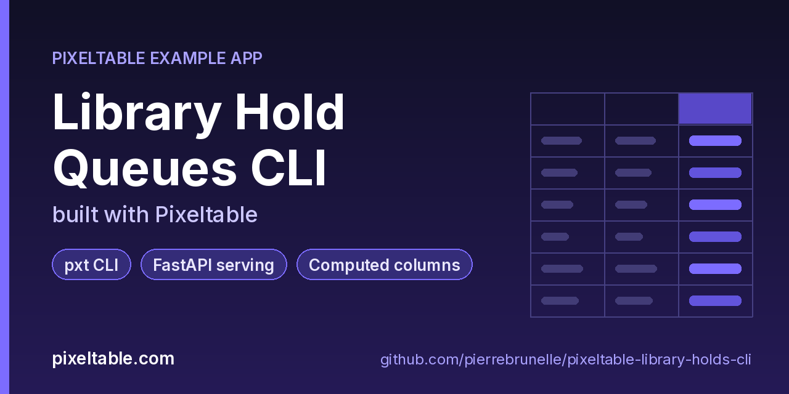

<!-- pixeltable-example-app: 20261101-library-holds-cli -->
# Library Hold Queues CLI built with Pixeltable



[](https://codespaces.new/pierrebrunelle/pixeltable-library-holds-cli?quickstart=1)
[](https://pixeltable.com)
[](https://pypi.org/project/pixeltable/)
[](https://github.com/pixeltable/pixeltable)
[](LICENSE)

`Books` holds the catalog (ISBN primary key, copies per title) and `Holds` is the queue: one row per patron request with branch, status and timestamps, plus computed columns for the hold-shelf slip code (`shelf_code`) and the pickup deadline (`pickup_deadline`, seven days after a hold turns ready), and B-tree indexes on ISBN and patron. `app.py` also defines `@pxt.query` functions for the queue of one title, a patron's holds and a branch's hold shelf. `cli.py` is an argparse tool over the same tables: `seed`, `place`, `queue`, `patron`, `ready`, `shelf`, `expire` and `stats` (waiting holds per title with a wait estimate). Set `PXT_TARGET` to a hosted database URI and the same commands run against Pixeltable Cloud. `cli.py doctor` runs `pxt config --json` and groups every setting by where it came from (environment, the global config file, this project's `pixeltable.toml`, or the default), then lists the secret names on a hosted target. `cli.py submit` is a small client for Pixeltable service routes: a background route answers `503` with a `Retry-After` header and the error code `JOB_REFUSED` when an instance already holds 64 unfinished jobs or is shutting down, and the helper waits the given interval and resubmits.

[Pixeltable](https://pixeltable.com) is open-source, Python-native **multimodal AI data infrastructure**: tables, incremental computed columns, UDFs, indexes and serving in one library, running locally or on Pixeltable Cloud.

> ⭐ **Like this example?** Star [pixeltable/pixeltable](https://github.com/pixeltable/pixeltable) on GitHub. It helps other developers find it.

## What this example shows

- **Incremental computed columns** powered by plain Python UDFs (`@pxt.udf`)
- **B-tree indexes** declared on the model (`__indexes__`) back the lookup queries
- **`pxt` CLI** for inspecting and operating the catalog
- **Importable UDF module**: UDFs live in `udfs.py`; tables and queries live in `app.py` (Pixeltable resolves UDFs by module path)
- **`pixeltable.toml`** declares a local database and a **Pixeltable Cloud** database, so the same code deploys with `pxt db update`

## Retrying a refused background job

A Pixeltable service route created with `background=True` returns `{"id": ..., "job_url": ...}` right away and runs the work in a thread. Each service instance holds at most 64 unfinished jobs; past that, or while the instance is shutting down, a submit answers `503` with `Retry-After` (whole seconds) and `{"error_code": "JOB_REFUSED", "retryable": true, "retry_after": 5}`. Any Pixeltable error that carries a `retry_after` (for example `DATABASE_UNAVAILABLE`) now sends the header too; non-retryable errors such as a duplicate primary key (`422 CONSTRAINT_VIOLATION`) don't. `submit_with_retry()` in `cli.py` waits the given interval and resubmits:

```python
r = requests.post(url, json=body)
if r.status_code == 503 and 'Retry-After' in r.headers:
    time.sleep(float(r.headers['Retry-After']))  # then submit again
```

Poll `job_url` for the result; a poll answers `410` once the instance that ran the job has stopped, so read results before restarting a service.

## Config layering

`pxt config` shows every setting with its source. An environment variable (for example `PIXELTABLE_PSYCOPG_LOG_LEVEL`) wins over the same key in `pixeltable.toml`, and `pxt config --source env` lists exactly those overrides. Installation-wide settings such as `file_cache_size_g` belong in the global file; a project `pixeltable.toml` that sets them is rejected.

## What's inside

| File | What it is |
|------|------------|
| `.devcontainer/devcontainer.json` | GitHub Codespaces / Dev Container config: Python 3.12, installs `requirements.txt` |
| `.github/social-preview.png` | Social preview image (1280x640) |
| `CITATION.cff` | Citation metadata (authors, license, release date, keywords) |
| `app.py` | Tables declared as Python classes and `@pxt.query` functions |
| `cli.py` | holds: a small command-line tool for a library hold queue, built on Pixeltable |
| `pixeltable.toml` | Project config: the local database plus a Pixeltable Cloud database (sizing, deploy excludes) |
| `udfs.py` | Pixeltable UDFs (`@pxt.udf`) in their own importable module, imported by `app.py` |
| `requirements.txt` / `pyproject.toml` | Dependencies (`pixeltable>=0.7.22`) |

**Tables**

| Table | Stored columns | Computed columns |
|-------|---------|------------------|
| `books` | `isbn`, `title`, `author`, `copies` | - |
| `holds` | `hold_id`, `isbn`, `patron`, `branch`, `placed_at`, `status`, `ready_at`, `label_secs` | `slip`, `pickup_by`, `label` |

## Run in your browser (GitHub Codespaces)

[](https://codespaces.new/pierrebrunelle/pixeltable-library-holds-cli?quickstart=1)

1. Click **Open in GitHub Codespaces** above (or [this link](https://codespaces.new/pierrebrunelle/pixeltable-library-holds-cli?quickstart=1)). The dev container installs Python 3.12 and `pixeltable>=0.7.22` from `requirements.txt`.
2. In the codespace terminal, create the tables, seed them and run the app:

   ```bash
   pxt schema update app.py libholds
   pxt schema update app.py libholds         # create books + holds (computed slip codes and pickup deadlines)
   python cli.py seed                        # 8 titles, 40 holds across 4 branches
   python cli.py queue 9780593135204         # queue order for one title
   python cli.py ready 9780593135204         # next waiting hold turns ready; pickup clock starts
   python cli.py shelf eastside              # the branch hold shelf with slip codes
   python cli.py stats                       # waiting holds per title + wait estimate
   python cli.py doctor                      # where every Pixeltable setting comes from
   PXT_TARGET=pxt://<org>:<db> python cli.py seed   # same commands against a hosted database
   ```


## Quickstart

Requires Python 3.11+ and `pixeltable>=0.7.22`.

```bash
git clone https://github.com/pierrebrunelle/pixeltable-library-holds-cli.git
cd pixeltable-library-holds-cli
python -m venv .venv && source .venv/bin/activate
pip install -r requirements.txt

# Create the tables in a local catalog directory named `libholds`
pxt schema update app.py libholds

pxt schema update app.py libholds         # create books + holds (computed slip codes and pickup deadlines)
python cli.py seed                        # 8 titles, 40 holds across 4 branches
python cli.py queue 9780593135204         # queue order for one title
python cli.py ready 9780593135204         # next waiting hold turns ready; pickup clock starts
python cli.py shelf eastside              # the branch hold shelf with slip codes
python cli.py stats                       # waiting holds per title + wait estimate
python cli.py doctor                      # where every Pixeltable setting comes from
PXT_TARGET=pxt://<org>:<db> python cli.py seed   # same commands against a hosted database
```

## Deploy to Pixeltable Cloud

The same `app.py` runs on [Pixeltable Cloud](https://pixeltable.com). Sign in (or get a free trial database with `pxt new`), point the second database entry in `pixeltable.toml` at your own database, then deploy:

```bash
pxt login                       # or: export PIXELTABLE_API_KEY=<your-api-key>
# edit pixeltable.toml: name = 'pxt://<your-org>:<your-db>'
pxt db update pxt://<your-org>:<your-db>                 # build the image and upload the project
pxt schema update app.py pxt://<your-org>:<your-db>       # create the tables at the database root (no per-app folder)
```

Keep keys in environment variables or `pxt secret set`, never in code.

## Code walkthrough

**1. Business logic is plain Python, in `udfs.py`.** A `@pxt.udf` function can be used as a column expression. Pixeltable records UDFs by module path (`udfs.pickup_deadline`), so they live in their own importable module rather than inline in the app: the daemon, serving workers and Pixeltable Cloud import it again by that path.

```python
# udfs.py
@pxt.udf
def pickup_deadline(ready_at: dt.datetime | None, days: int = PICKUP_DAYS) -> dt.datetime | None:
    """When a ready hold expires if nobody picks it up."""
    if ready_at is None:
        return None
    return ready_at + dt.timedelta(days=days)
```

**2. Tables are Python classes (`app.py`).** Annotated attributes are stored columns; attributes assigned an expression are **computed columns** (`slip`, `pickup_by`, `label`), evaluated incrementally on every insert or update and recomputed when their inputs change. Indexes live next to the columns.

```python
# app.py
class Holds(TableModel, name='holds'):
    """One patron hold request. status: waiting | ready | picked_up | expired | cancelled."""

    hold_id = pxt.Column(type=pxt.String, primary_key=True)
    isbn: pxt.String
    patron: pxt.String
    branch: pxt.String
    placed_at: pxt.Timestamp
    status: pxt.String
    ready_at: pxt.Timestamp | None
    label_secs: pxt.Float | None

    slip = shelf_code(hold_id, patron, branch)  # type: ignore[name-defined]  # noqa: F821
    pickup_by = pickup_deadline(ready_at)  # type: ignore[name-defined]  # noqa: F821
    label = slow_label(isbn, label_secs)  # type: ignore[name-defined]  # noqa: F821

    __indexes__ = [pxt.BtreeIndex(isbn), pxt.BtreeIndex(patron)]
```

**3. Queries are functions (`app.py`).** `@pxt.query` wraps a Pixeltable query so it can be called from Python or exposed as a route:

```python
# app.py
@pxt.query
def title_queue(isbn: str):
    """Open holds for one title, oldest first (queue order)."""
    return (
        Holds.where((Holds.isbn == isbn) & ((Holds.status == 'waiting') | (Holds.status == 'ready')))
        .order_by(Holds.placed_at)
        .select(Holds.hold_id, Holds.patron, Holds.branch, Holds.status, Holds.placed_at, Holds.slip)
    )
```

## Learn more

- 🌐 Website: https://pixeltable.com
- 📚 Docs: https://docs.pixeltable.com
- 💻 Source: https://github.com/pixeltable/pixeltable (⭐ star it if Pixeltable is useful to you)
- 📦 PyPI: https://pypi.org/project/pixeltable/
- 🧩 More example apps: https://pierrebrunelle.github.io/awesome-pixeltable-apps/

**[More Pixeltable example apps →](https://pierrebrunelle.github.io/awesome-pixeltable-apps/)**

---

<sub>Built as part of a daily series of Pixeltable example apps · Pixeltable 0.7.22 · Python, incremental computed columns · Licensed under Apache-2.0.</sub>
